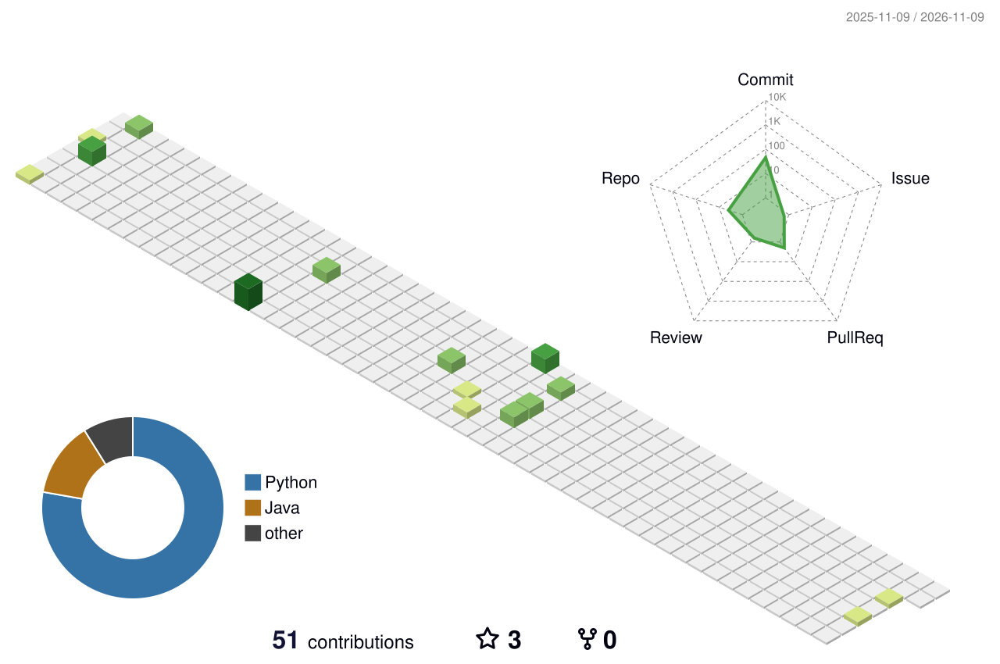

<!-- DIVERSA / Profile gateway. Public content is intentionally project-first. -->

**DIVERSA / AN OPEN-SOURCE ENGINEERING INITIATIVE / EARLY STAGE**

**The next meaningful project starts as code that somebody decides to make real.**  
DIVERSA is a growing set of open engineering experiments, research prototypes, and developer tools. The ambition is to turn the strongest ideas into software people depend on — and, where justified, products and independent ventures.

**[EXPLORE THE PROJECTS](#the-build-floor)** &nbsp;·&nbsp; **[FIND YOUR ENTRY POINT](#build-with-us)** &nbsp;·&nbsp; **[BROWSE ALL REPOSITORIES](https://github.com/divessa?tab=repositories)**

---

## THE BUILD FLOOR

*Working code first. Technical merit always. The roadmap is open to better ideas.*

### 01 / Historical Drift Analyzer

**Research infrastructure · Evaluated research prototype · Python / RAG / FAISS**

AI literature changes the meaning of its own vocabulary over time. Historical Drift Analyzer explores *temporal retrieval, reranking, and source-grounded synthesis* to investigate those changes with a reproducible RAG pipeline. It separates ingestion and indexing from query-time retrieval and evaluation.

**Why it matters:** Retrieval that ignores time can hide how ideas evolve. The architecture offers a test bed for studying evidence quality, time-aware search, and evaluable AI research tooling.

[**OPEN THE REPOSITORY**](https://github.com/divessa/Historical_Drift_Analyzer) &nbsp;·&nbsp; [Inspect the implementation](https://github.com/divessa/Historical_Drift_Analyzer/tree/main/src) &nbsp;·&nbsp; [Raise a technical proposal](https://github.com/divessa/Historical_Drift_Analyzer/issues) &nbsp;·&nbsp; [Review pull requests](https://github.com/divessa/Historical_Drift_Analyzer/pulls)

<picture>
  <source media="(prefers-color-scheme: dark)" srcset="./assets/repository-cards/historical-drift.dark.svg" />
  
</picture>

### 02 / BibCleaner Pro

**Scientific developer utility · Published script · Python / BibTeX**

Duplicate citations turn scientific bibliographies into unreviewable clutter. BibCleaner Pro uses brace-aware parsing and DOI, title, and URL matching to deduplicate BibTeX files while recording decisions in an audit log.

**Why it matters:** Small, deterministic tools can remove persistent friction from research workflows. A focused utility is also a useful foundation for discussing correctness, tests, interfaces, and packaging.

[**OPEN THE REPOSITORY**](https://github.com/divessa/bibcleaner-pro) &nbsp;·&nbsp; [Read the implementation](https://github.com/divessa/bibcleaner-pro/blob/main/dedupe_bib.py) &nbsp;·&nbsp; [Suggest an improvement](https://github.com/divessa/bibcleaner-pro/issues) &nbsp;·&nbsp; [Review pull requests](https://github.com/divessa/bibcleaner-pro/pulls)

<picture>
  <source media="(prefers-color-scheme: dark)" srcset="./assets/repository-cards/bibcleaner.dark.svg" />
  
</picture>

**More experiments, different degrees of maturity.** [Explore every public repository](https://github.com/divessa?tab=repositories). Each project stands on its actual source, not a fabricated roadmap or an invented product launch.

---

## BUILD WITH US

### Don't wait for a perfect project. Help make one better.

At an early stage, a careful review, a failing test case, an architectural argument, or a focused pull request can materially change the direction of a repository. You do not need a title or a reputation to make that difference. You need curiosity, evidence, and the willingness to ship.

| DISCOVER | CHALLENGE | BUILD | IMPROVE |
|:--|:--|:--|:--|
| Read the source and understand the problem. | Identify an assumption, missing edge case, or design trade-off. | Open an issue to discuss scope, then propose an implementation. | Test it, document the decision, and open a reviewable PR. |

**Start with a real codebase:**

- **Interested in retrieval, evaluation, or temporal AI?** [Explore Historical Drift Analyzer](https://github.com/divessa/Historical_Drift_Analyzer) and [open its issues](https://github.com/divessa/Historical_Drift_Analyzer/issues).
- **Interested in parsers, correctness, or research tooling?** [Explore BibCleaner Pro](https://github.com/divessa/bibcleaner-pro) and [open its issues](https://github.com/divessa/bibcleaner-pro/issues).
- **Not sure where to start?** [Browse the full repository collection](https://github.com/divessa?tab=repositories), choose a problem you can articulate, and open a well-scoped proposal in that repository.

**What makes early contributions worthwhile?** A chance to influence real design choices, build public technical work, learn through serious review, and receive attribution for accepted contributions. Maintainers and new contributors can disagree — respectfully — and let the code, tests, and evidence decide.

*No employment, equity, compensation, or ownership interest is implied by contribution. Any future commercial relationship would need a separate explicit agreement.*

---

## LIVING SIGNAL / THE KOI

**The work leaves traces. The koi moves with them.**

Real public GitHub activity → nightly regeneration → a different living signal. Generated by <a href="https://github.com/yalongwastaken/git-koi">git-koi</a>. The first GIF appears after the Koi workflow is run.

### CONTRIBUTION TERRAIN

<picture>
  <source media="(prefers-color-scheme: dark)" srcset="./profile-3d-contrib/profile-night-view.svg" />
  
</picture>

Generated by <a href="https://github.com/yoshi389111/github-profile-3d-contrib">GitHub Profile 3D Contrib</a>. Activity is evidence of work, not proof of adoption or business traction.

---

## ENGINEERING INTELLIGENCE

*What is being built, where the code lives, and how the public repository landscape changes.*

### Repository lifelines

<picture>
  <source media="(prefers-color-scheme: dark)" srcset="./assets/profile-cards/portfolio.dark.svg" />
  
</picture>

### Repository activity

<picture>
  <source media="(prefers-color-scheme: dark)" srcset="./assets/profile-cards/repositories.dark.svg" />
  
</picture>

Explore the language landscape

<picture>
  <source media="(prefers-color-scheme: dark)" srcset="./assets/profile-cards/languages.dark.svg" />
  
</picture>

Data cards by <a href="https://github.com/seijikohara/profile-cards-action">Profile Cards Action</a>. Images refresh from GitHub Actions after initial setup; repository metadata remains accessible through the links above if graphics are unavailable.

---

## FROM REPOSITORY TO REAL-WORLD IMPACT

A promising experiment is not a company. A useful library is not automatically a product. The progression has to be earned:

**Explore a difficult problem → build a credible implementation → prove usefulness → earn adoption → consider productization.**

DIVERSA is an early-stage direction, not a claim of an existing team, funded company, established customer base, or guaranteed outcome. The ambition is large; the evidence will have to be larger.

The principles stay simple: **ship what works, measure what matters, make the reasoning inspectable, and give credit where it is due.**

---

### THE NEXT COMMIT COULD CHANGE THE DIRECTION.

Don't just watch the roadmap emerge. Inspect the code. Question a design. Propose a better one. Build a small piece exceptionally well.

**[CHOOSE A REPOSITORY](https://github.com/divessa?tab=repositories) &nbsp;·&nbsp; [OPEN A TECHNICAL DISCUSSION](https://github.com/divessa/Historical_Drift_Analyzer/issues) &nbsp;·&nbsp; [START BUILDING](#build-with-us)**

**DIVERSA — BUILD BEYOND THE EXPECTED.**

Visual integrations: <a href="https://github.com/kyechan99/capsule-render">capsule-render</a> · <a href="https://github.com/DenverCoder1/readme-typing-svg">readme-typing-svg</a> · <a href="https://github.com/stats-organization/github-readme-stats-action">GitHub Readme Stats Action</a> · <a href="https://github.com/seijikohara/profile-cards-action">Profile Cards Action</a> · <a href="https://github.com/yalongwastaken/git-koi">git-koi</a> · <a href="https://github.com/yoshi389111/github-profile-3d-contrib">3D Contrib</a>. Third-party projects retain their own licenses and attribution.

